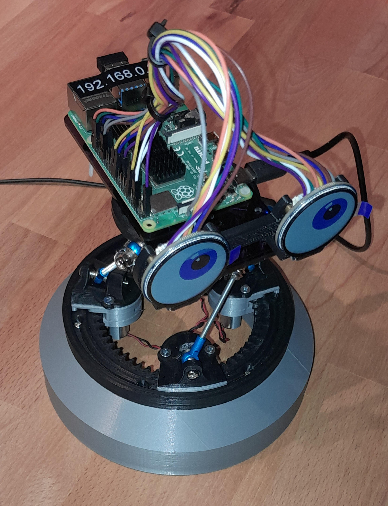

# robbie_openscad

OpenSCAD models for [robbie](https://github.com/busyDuckman/robbie), an open-source agentic robot.

The original robbie was made in Fusion 360. I want to shift to OpenSCAD so this project is a re-implementation of 
that work. I'm moving to OpenSCAD because it keeps getting better, and is a [FAIR](https://en.wikipedia.org/wiki/FAIR_data) way to maintain the design.

Video: https://youtu.be/8_o7KxZShpw

## Progress
The base has been reconstructed; some testing, then a few parts for the head, and we are done.

This is what the original looked like.  

## Basic Principle
The design goal was a head that can be placed anywhere in a room and look around to engage with people in an expressive manner. This requires a versatile neck construction (roll, pitch, yaw) with yaw being 360°.

The robot is based on a 3-DOF Stewart platform controlled by three motorised sleds that circle a collar.
This allows for natural-ish angular movement and 360-degree rotation using only 3 motors, spiffy.

The project is meant to be cheap, accessible, and reliable. To this end, high-reduction N20 motors act as actuators because the platform is not heavy enough to back-drive them. That lets the controller move them to set a new pose, then simply cut power.
The cheap and cheerful AS5600 magnetic rotary sensor tracks the motors' rotation and a micro switch is used as a home sensor.

## Repository Layout

- base.scad: the main platform and sleds.
- components.scad: stand-ins for bought parts (N20 motor, D2F switch, AS5600 board).
- helpers.scad, nop_screws.scad: misc
- screw_holes.scad: a related library, see: https://github.com/busyDuckman/screw_it
- ./stl/: exported parts.
- blender: agentically created scripts that rebuild the assembly animation for YouTube.

## Usage

    part = 0;  // What to draw ( see table below)

    expand = 1; // 0 = assembeld, 0.5 = base expanded only, 1.0 = fully expanded. 
                // Can be animated.

    slice_mode = 0; // cut the assembly: 0 none
                    //   1 X/Z plane (y = 0, through the home switch plunger)
                    //   2 plane turned 30 CCW, through a sled
                    //   3 both 1 and 2

    print_layout=true;  // position part for 3d printing

    // Part values
    //
    //    1 base               -1 d2f switch           100 sled assembly
    //    2 collar             -3 n20 motor            101 home switch pocket
    //    3 guide              -4 as5600 board
    //    4 pinion             -5 bearing screw (m3 x 25)
    //    6 home switch plug   -6 bearing nut (m3)
    //    7 lower sled         -7 sled screws (6g x 16)
    //    8 upper sled         -8 wire harness
    //    9 sled top           -9 magnet
    //                        -10 sled alignment pin

## Requirements

- An [OpenSCAD](https://openscad.org/) development snapshot.
- [BOSL2](https://github.com/BelfrySCAD/BOSL2) and [NopSCADlib](https://github.com/nophead/NopSCADlib) in your OpenSCAD libraries folder.

## License

MIT, see [LICENSE](LICENSE).
